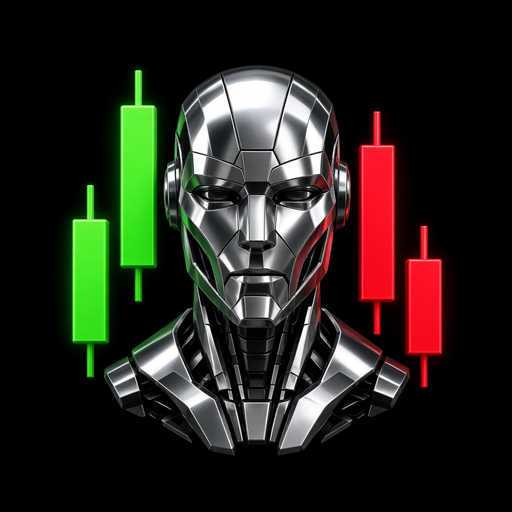
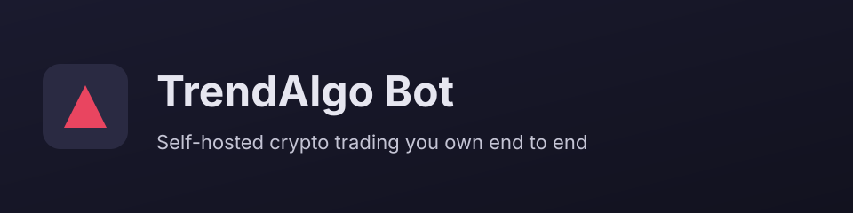
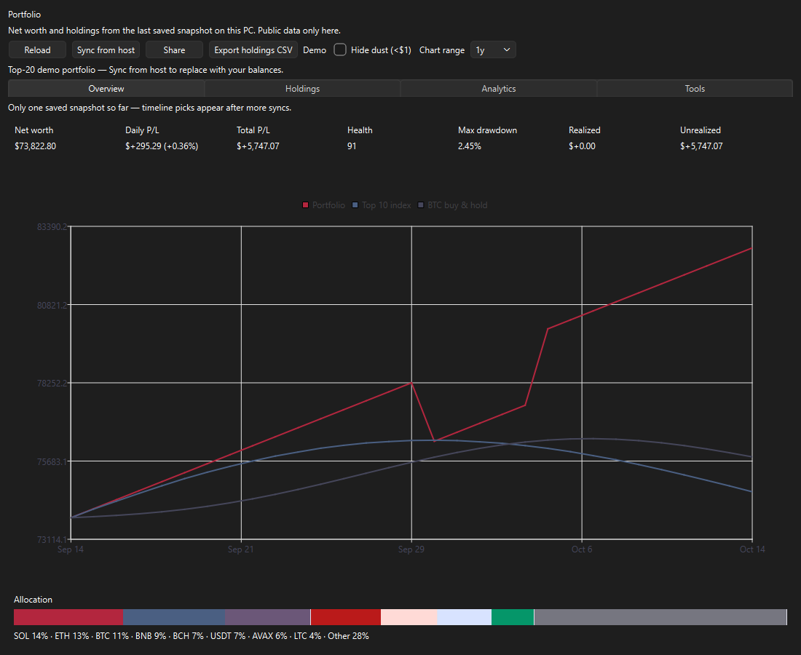
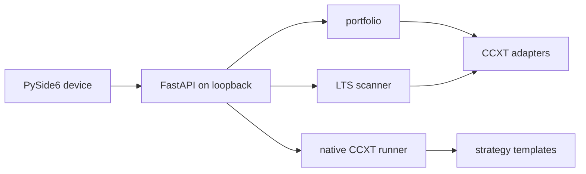

<p align="center">
  
</p>

<p align="center">
  
</p>

# TrendAlgo Bot


Source-available under Elastic License 2.0 — free for your own trading; no reselling as a service; no stripping billing.

## Pitch

**TrendAlgo Bot** is the crypto desk you own: a headless native CCXT engine on your VPS, plus a local PySide6 app that scans the tape, tracks the book, and only goes live when you say so.

You keep the keys, the SQLite, and the veto. Dry-run is the default. Live trading needs `TRENDALGO_MODE=live` and `scripts/go-live-gate.sh --approve` **per exchange**. No Freqtrade wrapper, no custodial account, no proprietary SDK, and no telemetry unless you opt in.

Secret Sauce has to beat fees and Buy & Hold under an honest Oracle ceiling — we never force-sort the leaderboard.

## What works today

- ✓ **Kraken research desk** — public Opportunity scan, deep OHLCV / OHLCVT, All-TA backtests, Secret Sauce Lab (no keys required for public Kraken)
- ✓ **Nine-CEX portfolio** — read-only sync across Kraken, Binance.US, Coinbase Advanced, Gemini, Bitstamp, Crypto.com, Binance, Bybit, OKX
- ✓ **DEX wallet track** — Ethereum / Base / Arbitrum Uniswap LP read; Solana SOL + known SPL tokens (optional RPC)
- ✓ **Native dry-run trading** — spot templates on vaulted venues; hard live gate stays in the way
- ✓ **Telegram alerts** — primary path; optional Grok Bot companion webhook when you set it
- ✓ **Secret Sauce Lab** — causal Enter/Exit recipes on the Oracle → Sauce → Buy & Hold spectrum

## Coming soon

- ✗ **Multi-CEX public scan parity** — keyed chart enrich works on vaulted CEX; full public desk still Kraken-first
- ✗ **DEX research desk** — thin Uniswap pool watch (Ethereum/Base) exists; Opportunity / All-TA / Sauce on-chain is not ready
- ✗ **TradFi / Forex live trade** — Alpaca equity BT (top-500) + forex rates research; paper dry-run only; live still gated

## Exchange support

Honest capability ladder — not every venue is “Kraken-complete.” Detail: [`docs/SUPPORT_MATRIX.md`](docs/SUPPORT_MATRIX.md) · roadmap: [`docs/EXCHANGE_ROADMAP.md`](docs/EXCHANGE_ROADMAP.md).

<!-- support-matrix:start -->

| Venue | Portfolio | Public scan | Keyed scan | Deep OHLCV / BT | Live trade | Status |
| --- | --- | --- | --- | --- | --- | --- |
| Kraken | ✓ | ✓ | ✓ | ✓ | ✓ | **Supported** |
| Binance.US | ✓ | ✗ | partial | partial | ✓ | **Supported (track + trade)** |
| Coinbase Advanced | ✓ | ✗ | partial | partial | ✓ | **Supported (track + trade)** |
| Gemini | ✓ | ✗ | partial | partial | ✓ | **Supported (track + trade)** |
| Bitstamp | ✓ | ✗ | partial | partial | ✓ | **Supported (track + trade)** |
| Crypto.com | ✓ | ✗ | partial | partial | ✓ | **Supported (track + trade)** |
| Binance | ✓ | ✗ | partial | partial | ✓* | **Supported (+ worldwide ack)** |
| Bybit | ✓ | ✗ | partial | partial | ✓* | **Supported (+ worldwide ack)** |
| OKX | ✓ | ✗ | partial | partial | ✓* | **Supported (+ worldwide ack)** |
| Ethereum (Uniswap) | wallet/LP | thin | ✗ | partial | ✗ | **Partial** |
| Base (Uniswap) | wallet/LP | thin | ✗ | partial | Base only* | **Partial** |
| Arbitrum One | wallet/LP | ✗ | ✗ | ✗ | ✗ | **Partial** |
| Solana DEX | ✓ | ✗ | ✗ | ✗ | ✗ | **Partial** |
| TradFi (Alpaca etc.) | partial | partial | thin | partial | ✗ | **Partial** |
| Forex (Alpaca rates) | ✗ | thin | thin | partial | ✗ | **Partial** |
<!-- support-matrix:end -->

\*Live trade starts in dry-run; live orders need the go-live gate per exchange. Worldwide CEX also need `WORLDWIDE_TRADING_ACK=1`. **Partial** = works, but thinner than Kraken public research.

## How the scanner works

1. **Opportunity / LTS** — find liquid names that look uniform and gainy on the tape.
2. **All-TA scan** — run the full indicator catalog on those names and score fee-honest backtests.
3. **Secret Sauce (SS) scan** — specialists mine a **causal Enter/Exit** recipe per coin. It must beat fees and Buy & Hold under an **Oracle** hindsight ceiling. Oracle is research-only (no Create Bot). The spectrum badge stays honest — Sauce is never force-sorted to #2.

More depth: [`docs/features/secret-sauce.md`](docs/features/secret-sauce.md).




## Strategies on All-TA

<!-- ta-strategy-categories:start -->

**192** indicators and patterns across the All-TA catalog. Expand a category to see every strategy id:

<details>
<summary>Candlestick patterns (60)</summary>

`CDL2CROWS`, `CDL3BLACKCROWS`, `CDL3INSIDE`, `CDL3LINESTRIKE`, `CDL3STARSINSOUTH`, `CDL3WHITESOLDIERS`, `CDLABANDONEDBABY`, `CDLADVANCEBLOCK`, `CDLBELTHOLD`, `CDLBREAKAWAY`, `CDLCLOSINGMARUBOZU`, `CDLCONCEALBABYSWALL`, `CDLCOUNTERATTACK`, `CDLDARKCLOUDCOVER`, `CDLDOJI`, `CDLDOJISTAR`, `CDLDRAGONFLYDOJI`, `CDLENGULFING`, `CDLEVENINGDOJISTAR`, `CDLEVENINGSTAR`, `CDLGAPSIDESIDEWHITE`, `CDLGRAVESTONEDOJI`, `CDLHAMMER`, `CDLHANGINGMAN`, `CDLHARAMI`, `CDLHARAMICROSS`, `CDLHIGHWAVE`, `CDLHIKKAKE`, `CDLHIKKAKEMOD`, `CDLHOMINGPIGEON`, `CDLIDENTICAL3CROWS`, `CDLINNECK`, `CDLINVERTEDHAMMER`, `CDLKICKING`, `CDLKICKINGBYLENGTH`, `CDLLADDERBOTTOM`, `CDLLONGLEGGEDDOJI`, `CDLLONGLINE`, `CDLMARUBOZU`, `CDLMATCHINGLOW`, `CDLMATHOLD`, `CDLMORNINGDOJISTAR`, `CDLMORNINGSTAR`, `CDLONNECK`, `CDLPIERCING`, `CDLRICKSHAWMAN`, `CDLRISEFALL3METHODS`, `CDLSEPARATINGLINES`, `CDLSHOOTINGSTAR`, `CDLSHORTLINE`, `CDLSPINNINGTOP`, `CDLSTALLEDPATTERN`, `CDLSTICKSANDWICH`, `CDLTAKURI`, `CDLTASUKIGAP`, `CDLTHRUSTING`, `CDLTRISTAR`, `CDLUNIQUE3RIVER`, `CDLUPSIDEGAP2CROWS`, `CDLXSIDEGAP3METHODS`

</details>

<details>
<summary>Fibonacci (2)</summary>

`FIB_EXT`, `FIB_RETRACE`

</details>

<details>
<summary>Oscillators (42)</summary>

`AO`, `APO`, `BIAS`, `BOP`, `CCI`, `CFO`, `CG`, `CMO`, `COPPOCK`, `CTI`, `DPO`, `FISHER`, `FOSC`, `INERTIA`, `KDJ`, `KST`, `LRSI`, `MFI`, `MOM`, `PGO`, `PO`, `PPO`, `PVO`, `QQE`, `QSTICK`, `ROC`, `ROCP`, `RSI`, `RSX`, `RVGI`, `RVI`, `SMI`, `STC`, `STOCH`, `STOCHF`, `STOCHRSI`, `TRIX`, `TRIXH`, `TSI`, `ULTOSC`, `UO`, `WILLR`

</details>

<details>
<summary>Trend & moving averages (54)</summary>

`ADX`, `ADXR`, `ALMA`, `AMAT`, `AROON`, `AROONOSC`, `DECREASING`, `DEMA`, `DM`, `DSP`, `DX`, `EMA`, `ER`, `ERI`, `FWMA`, `HILO`, `HMA`, `HT_TRENDLINE`, `HWMA`, `ICHIMOKU`, `INCREASING`, `JMA`, `KAMA`, `LINREGANGLE`, `MACD`, `MACDEXT`, `MACDFIX`, `MAMA`, `MINUS_DI`, `PLUS_DI`, `PSAR`, `PSL`, `PWMA`, `RMA`, `SAR`, `SAREXT`, `SINWMA`, `SLOPE`, `SMA`, `SSF`, `SUPERTREND`, `SWMA`, `T3`, `TD_SEQ`, `TEMA`, `TRIMA`, `TSIGNALS`, `TTM_TREND`, `VIDYA`, `VORTEX`, `VWMACD`, `WMA`, `XSIGNALS`, `ZLMA`

</details>

<details>
<summary>Volatility & bands (12)</summary>

`ACCBANDS`, `BBANDS`, `CVI`, `DONCHIAN`, `HWC`, `KC`, `MIDPOINT`, `MIDPRICE`, `SQUEEZE`, `SQUEEZE_PRO`, `STDEV`, `TOS_STDEVALL`

</details>

<details>
<summary>Volume & flow (18)</summary>

`AD`, `ADOSC`, `AOBV`, `CMF`, `EFI`, `EMV`, `EOM`, `KVO`, `NVI`, `OBV`, `PVI`, `PVT`, `VFI`, `VOSC`, `VP`, `VWAP`, `VWMA`, `WAD`

</details>

<details>
<summary>Price composites (4)</summary>

`HL2`, `HLC3`, `OHLC4`, `WCP`

</details>

<!-- ta-strategy-categories:end -->

## Quick start

Python **3.12** (not 3.13+), [uv](https://github.com/astral-sh/uv) recommended. No Node, no PWA.

```bash
git clone https://github.com/edwardlthompson/trendalgo-bot.git
cd trendalgo-bot
uv sync --extra dev
cp .env.example .env
export TRENDALGO_DATA_DIR=./data/dev
export TRENDALGO_MODE=dry-run
uv run python -m trendalgo.api.main

```

Local API binds **`127.0.0.1:8000`** (`TRENDALGO_API_HOST` / `TRENDALGO_API_PORT` or `PORT`).

```bash
curl http://127.0.0.1:8000/api/v1/health

```

Windows device UI (no console): `.\scripts\packaging\launch-device.ps1` after `.venv` exists. Optional extra: `uv sync --extra device`.

Keep `TRENDALGO_MODE=dry-run` until you are on an external VPS and have run the go-live gate. Exchange keys are optional for dry-run; they must be **trade + query**, never withdraw.

| Variable | Example | Purpose |
|----------|---------|---------|
| `TRENDALGO_MODE` | `dry-run` | Blocks live orders until you change it **and** pass the gate |
| `TRENDALGO_DATA_DIR` | `./data/dev` | SQLite, journals, portfolio DB |
| `TRENDALGO_API_PORT` | `8000` | Local FastAPI port |
| `TZ` | `UTC` | Scheduler timezone (portfolio snapshot is **00:00 UTC**) |
## Production (VPS, loopback 8080)

Production runs on an **external VPS**, not your laptop ([ADR-0002](docs/adr/0002-production-hosting.md)). Compose publishes the API as **`127.0.0.1:8080:8080` only**. Do not open host port 8080 on a public interface.

```bash
bash scripts/deploy-preflight.sh
export DEPLOY_HOST=user@your-vps.example
bash scripts/deploy-vps.sh

```

Reach it with an SSH tunnel or Tailscale:

```bash
ssh -N -L 8080:127.0.0.1:8080 user@your-vps
# then: curl http://127.0.0.1:8080/api/v1/health

```

Before live orders: `TRENDALGO_MODE=live` on the VPS, then `bash scripts/go-live-gate.sh --approve` per exchange. `GO_LIVE_APPROVED=1` and keys stay on the VPS.

Optional: `TELEGRAM_BOT_TOKEN` + `TELEGRAM_CHAT_ID` (primary alerts). Optional Grok Bot companion: `GROKBOT_WEBHOOK_URL` + `GROKBOT_WEBHOOK_KEY` — [feature doc](docs/features/grokbot-webhook.md).

## Architecture



| Layer | Technology |
|-------|------------|
| Trading engine | Native CCXT runner ([ADR-0010](docs/adr/0010-ccxt-native-engine.md)) |
| Domain | Python 3.12 — `src/trendalgo/` |
| Host API | FastAPI, local `127.0.0.1:8000`, prod loopback `:8080` |
| Local UI | PySide6 — `src/trendalgo/device/` |
| Data | SQLite on the VPS |
| License | Elastic License 2.0 ([ADR-0018](docs/adr/0018-elastic-license-v2.md)) |
Detail: [`docs/ARCHITECTURE.md`](docs/ARCHITECTURE.md) · [`docs/START_HERE.md`](docs/START_HERE.md) · [`docs/DEPLOYMENT.md`](docs/DEPLOYMENT.md)

## Security

- Dry-run default; live orders blocked until `go-live-gate.sh --approve`
- Production API on loopback; SSH tunnel or Tailscale, not a public 8080
- Trade + query API keys only — never withdraw
- Opt-in telemetry only
- Secrets stay in `.env` (never git) — see [`SECURITY.md`](SECURITY.md)

## License

Elastic License 2.0 (source-available) — [`LICENSE`](LICENSE). Performance license notes: [`docs/LICENSE_MODEL.md`](docs/LICENSE_MODEL.md).

## Contributing

See [`CONTRIBUTING.md`](CONTRIBUTING.md). Conventional Commits. Agents: [`AGENTS.md`](AGENTS.md) and [`docs/help/BATCH_COMMANDS.md`](docs/help/BATCH_COMMANDS.md).

```
src/trendalgo/   # portfolio, trading, scanner, billing, risk, API, device
config/          # exchange registry, founder defaults
docker/          # prod compose (loopback 8080)
docs/            # ADRs, roadmaps, runbooks
scripts/         # gates, deploy, packaging
tests/           # pytest

```

## What this is not

- A Freqtrade wrapper
- A hosted SaaS or a public trading API
- A place for secrets or production credentials
- “Nine exchanges at full Kraken research depth” — see the matrix above
