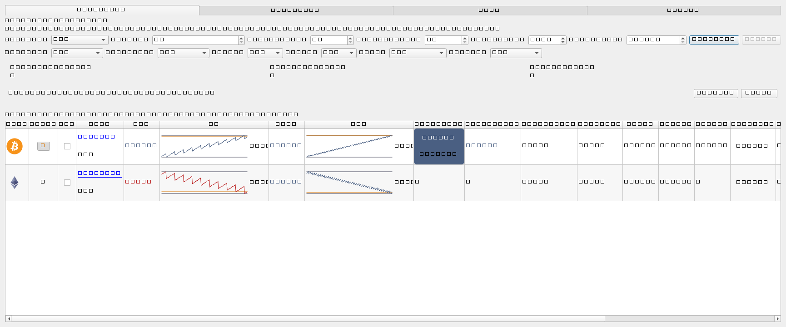
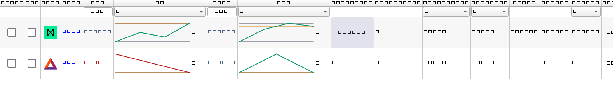
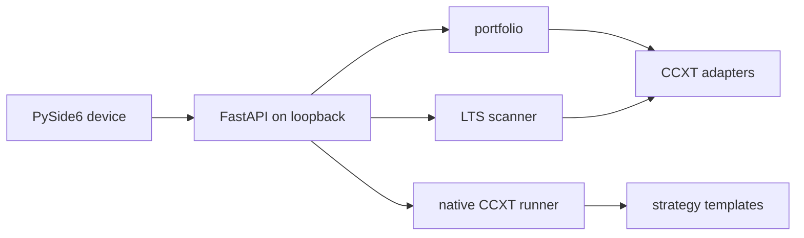

<p align="center">
  
</p>

# TrendAlgo Bot


Source-available under Elastic License 2.0 — free for your own trading; no reselling as a service; no stripping billing.

## Pitch

**TrendAlgo Bot** is the self-hosted crypto desk you actually own: a headless native CCXT engine on your VPS, plus a local PySide6 device app for research and control. It scans the tape, tracks the book, backtests recipes, and only goes live when you say so.

You keep the keys, the SQLite, and the veto. Dry-run is the default. Live trading needs `TRENDALGO_MODE=live` and `scripts/go-live-gate.sh --approve` **per exchange**. There is no Freqtrade, no custodial account, no proprietary SDK, and no telemetry unless you opt in.

## Why it's different

- **Native CCXT engine ([ADR-0010](docs/adr/0010-ccxt-native-engine.md))** — Freqtrade was removed. Spot orders, dry-run fills, and journals run in `src/trendalgo/trading/`.
- **LTS Scanner + Secret Sauce** — opportunity tiers from live OHLCV, then a causal Enter/Exit recipe that has to beat fees and Buy & Hold under an Oracle ceiling. No forced sort.
- **CoinStats-class portfolio** — read-only sync across nine CEX venues, charts vs an equal-weight top-10 index, on the device you already have.
- **Hard live gate** — the bot will not place live orders because a README said “go live”. The shell gate and `LiveGate` stay in the way.
- **Telegram first** — alerts always send on Telegram. An optional [Grok Bot webhook](docs/features/grokbot-webhook.md) can brief the same events in plain words; it is off until you set `GROKBOT_WEBHOOK_URL`, never delays Telegram, and can be filtered to save quota.

## Features



| Capability | What you get |
|------------|----------------|
| **Native algo trading** | Templates: `macd-kraken-1h`, `multi-tf-example`, `multi-tf-ta`, `smart-dca`, `grid-trading`, `strong-uptrend-scanner` — [native trading](docs/NATIVE_TRADING.md) |
| **LTS Scanner** | Qualified list, uniformity/gain tiers, device **Run scan** on public Kraken data (no keys) |
| **Secret Sauce Lab** | Per-coin causal Enter/Exit on the Oracle → Sauce → B&H spectrum — [write-up](docs/features/secret-sauce.md) |
| **Portfolio tracker** | Kraken, Binance.US, Coinbase Advanced, Gemini, Bitstamp, Crypto.com, plus Binance / Bybit / OKX with `WORLDWIDE_TRADING_ACK=1` — [exchange roadmap](docs/EXCHANGE_ROADMAP.md) |
| **Device app** | PySide6: portfolio, scanner, backtest, plan/bots, alerts, settings. Windowed launch: `.\scripts\packaging\launch-device.ps1` |
| **Alerts** | Telegram is primary. Optional Grok Bot HTTPS webhook for an AI companion brief |
| **Research** | Backtest library, walk-forward, Monte Carlo, TA catalog |
| **Safety** | Dry-run default, per-exchange go-live, loopback production API |




## Quick start

Python **3.12** (not 3.13+), [uv](https://github.com/astral-sh/uv) recommended. No Node, no PWA.

```bash
git clone https://github.com/edwardlthompson/trendalgo-bot.git
cd trendalgo-bot
uv sync --extra dev
cp .env.example .env
export TRENDALGO_DATA_DIR=./data/dev
export TRENDALGO_MODE=dry-run
uv run python -m trendalgo.api.main
```

Local API binds **`127.0.0.1:8000`** (`TRENDALGO_API_HOST` / `TRENDALGO_API_PORT` or `PORT`).

```bash
curl http://127.0.0.1:8000/api/v1/health
```

Windows device UI (no console): `.\scripts\packaging\launch-device.ps1` after `.venv` exists. Optional extra: `uv sync --extra device`.

Keep `TRENDALGO_MODE=dry-run` until you are on an external VPS and have run the go-live gate. Exchange keys are optional for dry-run; they must be **trade + query**, never withdraw.

| Variable | Example | Purpose |
|----------|---------|---------|
| `TRENDALGO_MODE` | `dry-run` | Blocks live orders until you change it **and** pass the gate |
| `TRENDALGO_DATA_DIR` | `./data/dev` | SQLite, journals, portfolio DB |
| `TRENDALGO_API_PORT` | `8000` | Local FastAPI port |
| `TZ` | `UTC` | Scheduler timezone (portfolio snapshot is **00:00 UTC**) |

## Production (VPS, loopback 8080)

Production runs on an **external VPS**, not your laptop ([ADR-0002](docs/adr/0002-production-hosting.md)). Compose publishes the API as **`127.0.0.1:8080:8080` only**. Do not open host port 8080 on a public interface.

```bash
bash scripts/deploy-preflight.sh
export DEPLOY_HOST=user@your-vps.example
bash scripts/deploy-vps.sh
```

Reach it with an SSH tunnel or Tailscale:

```bash
ssh -N -L 8080:127.0.0.1:8080 user@your-vps
# then: curl http://127.0.0.1:8080/api/v1/health
```

Before live orders: `TRENDALGO_MODE=live` on the VPS, then `bash scripts/go-live-gate.sh --approve` per exchange. `GO_LIVE_APPROVED=1` and keys stay on the VPS.

Optional: `TELEGRAM_BOT_TOKEN` + `TELEGRAM_CHAT_ID` (primary alerts). Optional Grok Bot companion: `GROKBOT_WEBHOOK_URL` + `GROKBOT_WEBHOOK_KEY` — [feature doc](docs/features/grokbot-webhook.md).

## Architecture



| Layer | Technology |
|-------|------------|
| Trading engine | Native CCXT runner ([ADR-0010](docs/adr/0010-ccxt-native-engine.md)) |
| Domain | Python 3.12 — `src/trendalgo/` |
| Host API | FastAPI, local `127.0.0.1:8000`, prod loopback `:8080` |
| Local UI | PySide6 — `src/trendalgo/device/` |
| Data | SQLite on the VPS |
| License | Elastic License 2.0 ([ADR-0018](docs/adr/0018-elastic-license-v2.md)) |

Detail: [`docs/ARCHITECTURE.md`](docs/ARCHITECTURE.md) · [`docs/START_HERE.md`](docs/START_HERE.md) · [`docs/DEPLOYMENT.md`](docs/DEPLOYMENT.md)

## Security

- Dry-run default; live orders blocked until `go-live-gate.sh --approve`
- Production API on loopback; SSH tunnel or Tailscale, not a public 8080
- Trade + query API keys only — never withdraw
- Opt-in telemetry only
- Secrets stay in `.env` (never git) — see [`SECURITY.md`](SECURITY.md)

## License

Elastic License 2.0 (source-available) — [`LICENSE`](LICENSE). Performance license notes: [`docs/LICENSE_MODEL.md`](docs/LICENSE_MODEL.md).

## Contributing

See [`CONTRIBUTING.md`](CONTRIBUTING.md). Conventional Commits. Agents: [`AGENTS.md`](AGENTS.md) and [`docs/help/BATCH_COMMANDS.md`](docs/help/BATCH_COMMANDS.md).

```
src/trendalgo/   # portfolio, trading, scanner, billing, risk, API, device
config/          # exchange registry, founder defaults
docker/          # prod compose (loopback 8080)
docs/            # ADRs, roadmaps, runbooks
scripts/         # gates, deploy, packaging
tests/           # pytest
```

## What this is not

- A Freqtrade wrapper
- A hosted SaaS or a public trading API
- A place for secrets or production credentials
